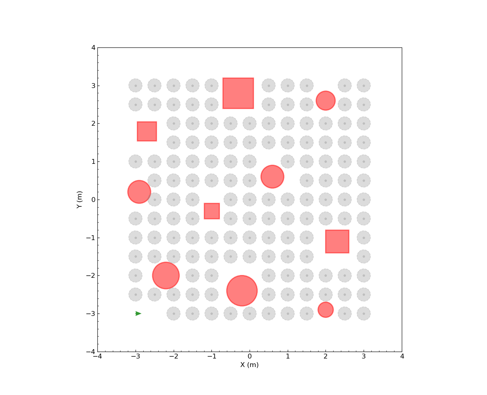
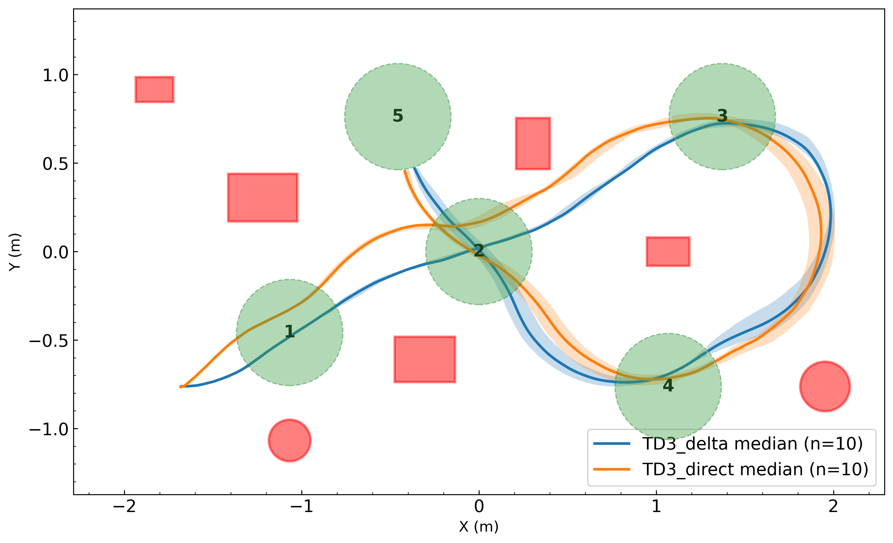
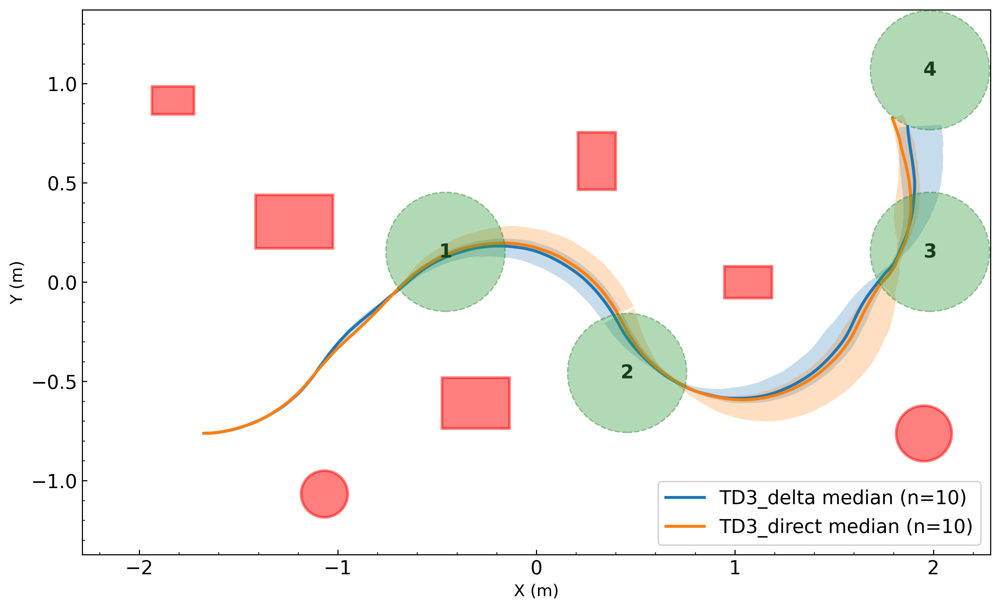
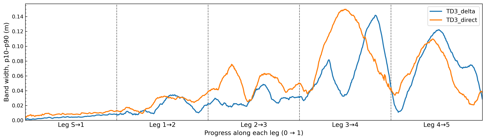

# X3_ROS2_ws

**Deploying deep reinforcement learning (TD3) navigation policies and edge vision models on a Yahboom ROS Master X3 robot, using ROS 2 Humble on a Jetson Orin.**

This workspace is the robot-side half of a graduate research project. Navigation policies are trained in a separate simulation environment ([training repo — link TBD](#)). This repo:

1. loads the trained policies onto a real mecanum-wheel robot,
2. benchmarks them against a classical Artificial Potential Field (APF) planner in Gazebo, and
3. runs them on the physical robot in a lab test bed.

It also contains the perception stack for the project's long-term goal: a **socially assistive robot**. That robot should detect people, recognize their emotional state, and navigate toward them.

---

## Contributions

- **End-to-end sim-to-real DRL navigation stack.** A ROS 2 action server (`x3_drl_policy`) runs a TD3 actor (exported from Stable-Baselines3) at 50 Hz. It builds the same 27-D observation the policy saw in training: relative goal position and distance, heading and bearing (sin/cos), current velocity, and 18 min-pooled LiDAR sectors. The observation is normalized with the training statistics. Policies and APF share one `NavigateToGoal` action interface, so they are interchangeable.
- **Comparison of two action parameterizations.**
  - **TD3_direct**: the policy outputs absolute linear and angular velocity.
  - **TD3_delta**: the policy outputs a bounded *change* in velocity (±0.05 per step), which gives smoother, rate-limited commands.

  Both are evaluated in simulation and on the physical robot.
- **Reproducible large-scale evaluation harness.** `x3_experiment_runner` runs headless Gazebo trials automatically. Each planner is tested on 139 fixed goal poses. Ground-truth success and path-length metrics are logged per trial, along with full time series (ground-truth vs. EKF odometry, commanded vs. measured wheel velocity).
- **Real-world repeatability study.** Each policy drives multi-waypoint sequences 10 times in a 9 ft × 15 ft lab arena. Poses are recorded from both robot odometry and a ceiling-camera ground-truth tracker. The analysis covers trajectory spread, per-leg timing and clearance, and Mann–Whitney U tests.
- **Edge-deployable perception.**
  - YOLOv5n/YOLOv8n face detection (WIDER FACE) with depth-based 3D face localization, from the Orbbec Astra depth camera.
  - A face-follower node that turns detected faces into navigation goals.
  - An emotion-recognition node, plus a TensorRT latency benchmark of **75 FER models** (FER2013 and RAF-DB) on the Jetson.
- **Robot bringup and state estimation.** URDF/xacro model, a mecanum driver over the Rosmaster serial board, RPLIDAR with rear masking, and fused odometry. The fusion combines rf2o laser odometry, the IMU, and wheel odometry in a `robot_localization` EKF, using a custom covariance filter. Gazebo worlds mirror the real setup.

---

## Tech Stack

| Layer | Tools |
|---|---|
| Robot | Yahboom ROS Master X3 (mecanum), RPLIDAR, Orbbec Astra Pro Plus RGB-D camera, IMU |
| Compute | NVIDIA Jetson Orin Nano/NX, JetPack 6.2.1, CUDA 12.6, TensorRT 10.3, cuDNN 9.3 |
| Middleware | ROS 2 Humble (rclpy, actions, `robot_localization`, `ros2_control`, `image_transport`, `tf2`) |
| Simulation | Gazebo (gz-sim) via `ros_gz`, `gz_ros2_control`; 5 obstacle worlds + empty world |
| Learning / inference | PyTorch, Stable-Baselines3 (TD3), Gymnasium, ONNX Runtime GPU (TensorRT EP), OpenCV |
| Vision models | YOLOv5n / YOLOv8n (face), MobileNetV3, MobileViT, ResNet, EfficientNet, GhostNet V2/V3, FastViT (emotion) |
| Odometry | `rf2o_laser_odometry`, EKF (`robot_localization`), custom covariance filter |
| Analysis | Python, NumPy, pandas, SciPy, Matplotlib, Jupyter |
| DevOps | Docker (robot image + VS Code devcontainer), NVIDIA Container Toolkit, git submodules |

---

## Repository Layout

```
src/
├── x3_bringup/            # Real-robot launch: driver, LiDAR, camera, odometry/EKF, RViz
├── x3_description/        # URDF/xacro, meshes, Gazebo worlds (world_1..5), sim launch files
├── x3_drl_policy/         # TD3 policy action server + exported policies (policies/TD3_xxxxx_<ckpt>)
├── x3_apf_planner/        # Artificial Potential Field baseline action server
├── x3_nav_interfaces/     # NavigateToGoal / NavigateToGoalSequence actions
├── x3_nav_bringup/        # Goal(-sequence) clients/servers, face follower, waypoint paths
├── x3_experiment_runner/  # Automated Gazebo trial orchestrator (G2G benchmark)
├── x3_visual/             # Face detection + emotion recognition nodes, ONNX models
├── x3_covariance_filter/  # Covariance injection/filtering for EKF inputs
├── x3_control/            # Keyboard teleop
└── (submodules) rplidar_ros, rf2o_laser_odometry, fisheye_calibration, astra_camera
scripts/
├── G2G_analysis.ipynb               # Success rate / SPL over simulation trials
├── benchmark_emotion_recognition.py # Jetson TensorRT latency benchmark
├── viz/                             # Path, velocity, and repeatability plotting
├── figures/, viz/figures/           # Generated figures
└── recorded_paths/                  # Recorded runs (sim + lab) per policy
trial_results/                       # Per-planner G2G CSVs + per-trial time series JSON
robot_ws/                            # Robot Dockerfile, build/start scripts
docs/SETUP.md                        # Full robot setup & deployment guide
```

**Policy naming:** `TD3_<run id>_<checkpoint>`. Runs **00384 and 00386–00395 use the *delta* action mode**. All others use *direct*. `policy_node` picks the mode automatically from the run ID.

---

## Results

### 1. Simulation: goal-to-goal benchmark (Gazebo, `world_1`)

<p align="center"></p>

*`world_1` layout: obstacles in red, goal poses as grey discs, robot start marked with a green arrow.*

Each planner tried to reach **139 goal poses** from a fixed start. A trial fails on collision (LiDAR range < 0.21 m) or on timeout. The metrics are success rate and **SPL** (Success weighted by Path Length = success × straight-line distance / distance travelled). Each policy group is 5–10 independently trained TD3 runs, reported as mean ± std across runs. `*` means the best-performing checkpoint was used for each run instead of the final one.

| Planner | Success rate (%) | SPL |
|---|---|---|
| APF (baseline) | 93.5 | 0.758 |
| TD3_direct (final ckpt, 5 runs) | 92.8 ± 2.3 | 0.852 ± 0.025 |
| **TD3_direct\*** (best ckpt, 10 runs) | **94.9 ± 3.0** | **0.855 ± 0.031** |
| TD3_delta (final ckpt, 10 runs) | 83.6 ± 18.8 | 0.718 ± 0.158 |
| TD3_delta\* (best ckpt, 10 runs) | 92.3 ± 6.1 | 0.796 ± 0.057 |

Best individual policies: `TD3_00400_700` (99.3 %), and `TD3_00384_500` / `TD3_00390_800` (98.6 %).

**Takeaways**
- The TD3 policies match or beat APF on success rate and take noticeably more efficient paths (SPL 0.85 vs. 0.76). APF never collided, but it failed on 9 goals by timing out, which is typical of potential-field local minima.
- Checkpoint selection matters, especially for delta policies. Picking the best checkpoint raises mean success from 83.6 % to 92.3 % and cuts the run-to-run spread by about 3×. One delta run (`TD3_00389_1000`) collapsed to 28 % success at its final checkpoint.
- In simulation, direct-action policies are slightly more efficient and more consistent than delta policies.

### 2. Real robot: multi-goal repeatability (lab arena)

The best delta and direct policies each ran two waypoint sequences **10 times** on the physical X3 (delta: `TD3_00395_1000` / `TD3_00388_1000`; direct: `TD3_00404_500` / `TD3_00405_1000`). Shaded bands show the 10th–90th percentile lateral spread around the median trajectory.

<p align="center">


</p>
<p align="center"><em>Median trajectories ± p10–p90 bands. Left: Path 1 (5 waypoints). Right: Path 2 (4 waypoints).</em></p>

<p align="center"></p>
<p align="center"><em>Path 1 trajectory spread (p10–p90 band width) along each leg.</em></p>

| Path 1 (5 legs) | TD3_delta | TD3_direct | Mann–Whitney p |
|---|---|---|---|
| Total duration (s) | **43.2 ± 0.6** (CV 1.4 %) | 56.6 ± 9.1 (CV 16 %) | 0.0002 |
| Path length (m) | 7.83 ± 0.07 | 7.92 ± 0.14 | 0.14 (n.s.) |
| Min obstacle clearance (m) | **0.248 ± 0.023** | 0.083 ± 0.020 | 0.0002 |
| Leg 4 time (s) | **13.3 ± 0.4** | 23.8 ± 9.1 | 0.0004 |

| Path 2 (4 legs) | TD3_delta | TD3_direct | Mann–Whitney p |
|---|---|---|---|
| Total duration (s) | 28.4 ± 0.8 | 29.2 ± 1.0 | 0.10 (n.s.) |
| Path length (m) | 5.19 ± 0.13 | 5.35 ± 0.20 | 0.054 |
| Min obstacle clearance (m) | 0.335 ± 0.024 | 0.321 ± 0.059 | 0.79 (n.s.) |
| Leg 4 length (m) | **0.85 ± 0.01** | 0.90 ± 0.03 | 0.002 |

**Takeaways**
- **The sim ranking flips on hardware.** Direct policies looked slightly better in simulation, but the delta policy is clearly more reliable on the real robot.
  - On Path 1 it was faster (43 s vs. 57 s) and far more repeatable (duration CV 1.4 % vs. 16 %).
  - It kept about 3× more clearance from obstacles (0.25 m vs. 0.08 m).
  - The direct policy's Leg 4 time ranged from 13.6 s to 40.4 s. Its bang-bang velocity commands produce hesitation and oscillation near obstacles once real actuation dynamics and sensor noise are involved.
- On the simpler Path 2, both policies perform similarly, with the delta policy taking slightly shorter, tighter paths.
- Rate-limiting the action space (delta mode) works as a cheap, effective sim-to-real regularizer.

Per-policy figures (`repeat_*`, `spread_*`, `boundaries_*` showing per-run waypoint arrival points) and the raw CSVs are in [`scripts/viz/figures/`](scripts/viz/figures). Additional simulation path and velocity plots (APF vs. TD3 across worlds 1–5) are in [`scripts/figures/`](scripts/figures).

### 3. Emotion recognition latency on Jetson (TensorRT)

75 ONNX emotion classifiers (11 architecture families, trained on FER2013 and RAF-DB) were benchmarked on the Jetson Orin with the TensorRT execution provider (50 warm-up + 500 timed runs each). "End-to-end" includes preprocessing.

| Model family | Input | Inference (ms) | End-to-end (ms) | End-to-end FPS |
|---|---|---|---|---|
| MobileNetV3-Small | 224² | ~2.8 | **~4.5** | **~220** |
| MobileNetV3-Large | 224² | ~3.9 | ~5.9 | ~165 |
| MobileViT-XXS *(deployed default)* | 256² | ~5.3 | ~6.4 | ~155 |
| ResNet-18 / 34 / 50 | 224² | 3.3 / 4.9 / 6.4 | 6.2 / 7.7 / 9.1 | 160 / 130 / 110 |
| MobileViT-XS | 256² | ~6.4–7.6 | ~7.5–8.8 | ~115–135 |
| GhostNetV2 / V3 | 224² | ~7.7–9.6 | ~9.6–12.0 | ~83–104 |
| EfficientNet-B0 / B1 / B2 | 224²–260² | 6.6 / ~9.5 / 12.4 | 9.6 / ~13 / 16.4 | 104 / ~77 / 61 |
| FastViT-T8 / T12 / S12 | 256² | 7.2 / 10.3 / 11.7 | 10.6 / 14.0 / 15.3 | 94 / 71 / 65 |

Every model runs well above camera frame rate (≥ 61 FPS), so the choice can be driven by accuracy rather than latency. Full results: [`scripts/benchmark_output/`](scripts/benchmark_output).

---

## Getting Started

See **[docs/SETUP.md](docs/SETUP.md)** for the full robot setup (Docker, GPU libraries, ONNX Runtime GPU, networking). Short version:

```bash
git clone --recursive https://github.com/MinhNguyen2000/X3_ROS2_ws.git ~/X3_ROS2_ws
cd ~/X3_ROS2_ws
bash robot_ws/build.sh            # build the robot Docker image
bash robot_ws/setup_gpu_libs.sh   # copy TensorRT/cuDNN libs from host
bash robot_ws/start_container.sh  # start the container
docker exec -it ros2_humble bash
colcon build --symlink-install && source install/setup.bash
```

**Real robot**
```bash
ros2 launch x3_bringup robot.launch.py        # driver, LiDAR, camera, perception, DRL policy
ros2 launch x3_bringup odom.launch.py         # rf2o + covariance filter + EKF
ros2 run x3_nav_bringup goal_sequence_server
ros2 run x3_nav_bringup goal_sequence_client  # sends waypoint paths from x3_nav_bringup/paths/
```

**Simulation benchmark**
```bash
# starts headless Gazebo, runs every goal in goals/goals_<world>.json, writes to trial_results/
ros2 run x3_experiment_runner trial_orchestrator --planner DRL --world_name world_1
ros2 run x3_experiment_runner trial_orchestrator --planner APF --world_name world_1
```

Choose a policy with `--ros-args -p model_name:=TD3_00388_1000` on `x3_drl_policy policy_node`. Use `x3_apf_planner apf_node` for the baseline.

---

## Acknowledgements

Third-party packages included as submodules: [rplidar_ros](https://github.com/Slamtec/rplidar_ros), [rf2o_laser_odometry](https://github.com/MAPIRlab/rf2o_laser_odometry), [Fisheye_Camera_Calibration_ROS2](https://github.com/LiZheng1997/Fisheye_Camera_Calibration_ROS2), and the Orbbec `astra_camera` driver. The Rosmaster serial driver is provided by Yahboom.
